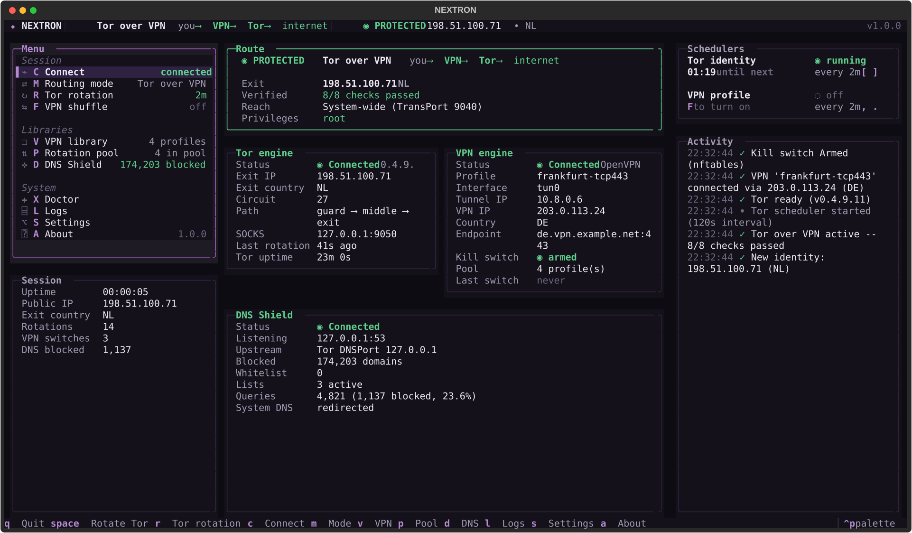
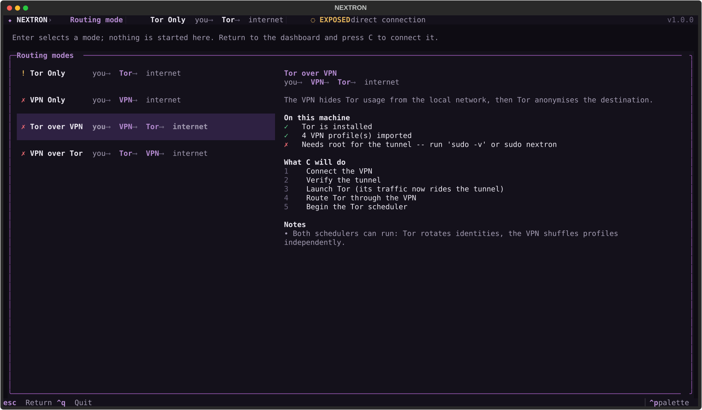
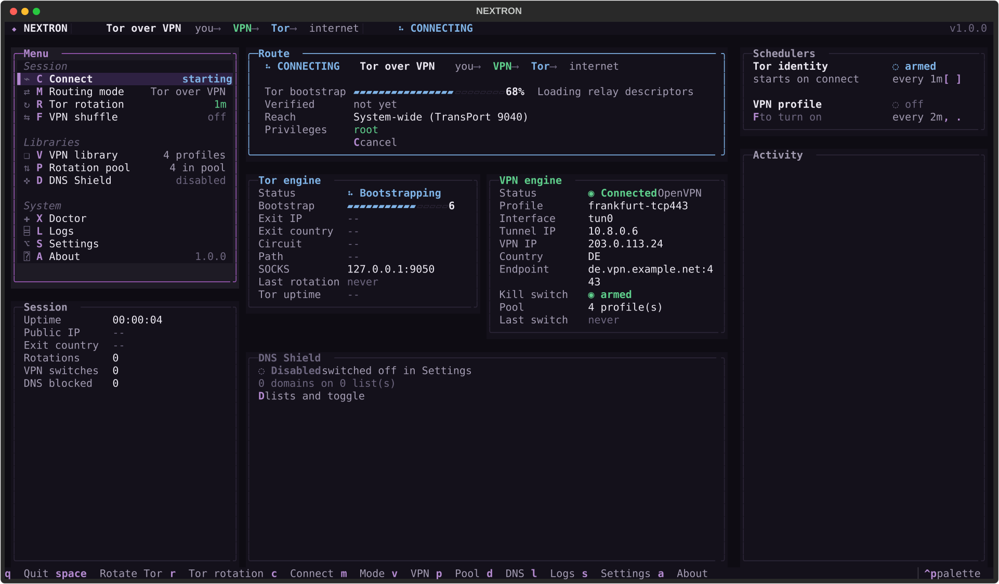
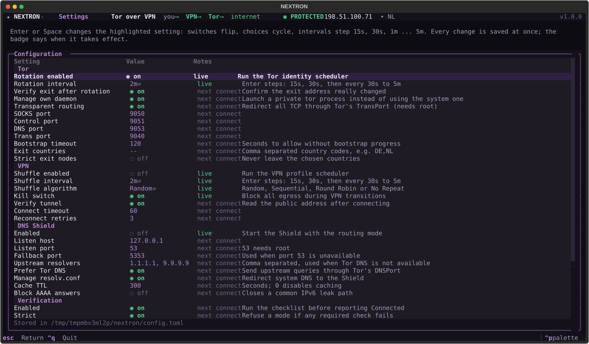

<div align="center">

```
                                  )
                               ( /(                )
                               )\())   (     )  ( /( (
                              ((_)\   ))\ ( /(  )\()))(    (    (
                               _((_) /((_))\())(_))/(()\   )\   )\ )
                              | \| |(_)) ((_)\ | |_  ((_) ((_) _(_/(
                              | .` |/ -_)\ \ / |  _|| '_|/ _ \| ' \))
                              |_|\_|\___|/_\_\  \__||_|  \___/|_||_|
```

### Your traffic, four ways out, and one honest answer to "am I protected?"

**Tor · VPN · Tor over VPN · VPN over Tor**, a nftables kill switch, an ad-blocking DNS Shield,<br>
and a verifier that checks every connection instead of assuming it worked. All of it in your terminal.

[**Website**](https://jeevansai-k.github.io/nextron/) ·
[Quick start](#-sixty-seconds-to-your-first-route) ·
[The four routes](#-four-routes-one-keystroke-each) ·
[Docs](docs/USAGE.md)




<sub>Tor over VPN, verified 8/8, kill switch armed, DNS Shield on. The addresses are documentation examples.</sub>

</div>

---

## ⬥ The problem with privacy tools

Most of them say **"Connected"** the moment a process starts. Then they say it
again when the tunnel has silently died, when DNS is leaking around it, and when
only your browser was ever covered.

NEXTRON is built on one rule: **nothing on screen is assumed.** Every status
came from a daemon's own output, a socket that answered, or a request that came
back. After every connect it measures your exit address, compares it with the
one you started with, probes for DNS and IPv6 leaks, and **tears the route down
if a required check fails**, rather than let you believe something false.

The header line answers the only question that matters, in one word:

| | Means |
|:---:|---|
| 🟢 **`PROTECTED`** | The route is up, verified, and covers the whole machine |
| 🟠 **`PROXY ONLY`** | Tor works, but only apps pointed at its SOCKS port use it (no root) |
| 🟠 **`EXPOSED`** | Nothing is connected; you are on the direct line |
| 🔵 **`CONNECTING`** | A route is being built; press `C` again to cancel cleanly |
| 🔴 **`FAILED`** | It did not come up, and the reason is printed in plain words |

Colour always means state: green is carrying traffic, amber needs you, red
failed, blue is working. The violet only marks where your keys go.

---

## ⬥ Four routes, one keystroke each

Exactly one is live at a time. Switching tears the old chain down, in reverse
order, before the new one goes up.

```
  Tor Only        you ⟶ Tor ⟶ internet              three hops, no account, no bill
  VPN Only        you ⟶ VPN ⟶ internet              speed and a stable exit
  Tor over VPN    you ⟶ VPN ⟶ Tor ⟶ internet        your ISP sees a VPN, the guard never sees you
  VPN over Tor    you ⟶ Tor ⟶ VPN ⟶ internet        the VPN never learns your address (TCP OpenVPN)
```



The mode picker checks your machine first. Tor installed? Profiles imported? A
TCP profile for VPN over Tor? Root for the tunnel? Each mode gets a ✓, ! or ✗
**before** you press `C`, not after it fails.

---

## ⬥ What happens when you press `C`

```
  1  measure the unprotected exit address        so there is something to compare against
  2  arm the nftables kill switch                before anything moves
  3  bring the first hop up                      tor bootstrap, or openvpn / wg-quick
  4  wait for the daemon's own ready marker      not a sleep, not a guess
  5  bring the second hop up, if there is one
  6  install transparent routing                 when running as root
  7  VERIFY ─┬ did the exit address change?      required
             ├ does Tor confirm the circuit?     required in Tor modes
             ├ is DNS resolving outside?
             └ is IPv6 escaping?
  8  passed  → the dashboard goes green
     failed  → tear down, release the kill switch, show the report (I)
```



Changed your mind half way? Press `C` again. NEXTRON cancels and removes whatever
it had already started: the Tor daemon, the OpenVPN child, the firewall rules.

---

## ⬥ Sixty seconds to your first route

```bash
git clone https://github.com/jeevansai-k/nextron && cd nextron
./scripts/install-prerequisites.sh        # packages, virtualenv, and a `nextron` launcher
nextron doctor                            # every missing piece, by name, with its fix
```

Drop your own files in, then launch:

```bash
cp ~/Downloads/*.ovpn  ~/.config/nextron/Sources/'VPN Profiles'/
cp ~/Downloads/ads.txt ~/.config/nextron/Sources/'DNS list'/
sudo nextron
```

**`M`** pick a route → **`V`** pick a profile → **`C`** connect.

<details>
<summary><b>Rather install by hand?</b></summary>

```bash
sudo apt install tor openvpn wireguard-tools nftables iproute2 python3-venv
python3 -m venv .venv
.venv/bin/pip install -e .
```

</details>

<details>
<summary><b>Why <code>sudo</code>?</b></summary>

Without it NEXTRON still runs: Tor works for any app pointed at its SOCKS proxy,
and the header says **PROXY ONLY** so you are never misled. With root the whole
machine is routed, VPN tunnels can be created, and the kill switch can be armed.
NEXTRON never escalates quietly. If sudo needs a password, the action that needs
it stops at once and tells you to run `sudo -v` or `sudo nextron`.

| Operation | Root? | Because |
|---|:---:|---|
| Tor SOCKS proxy | no | a user-space port |
| OpenVPN / WireGuard tunnels | **yes** | creating a `tun` / `wg` device |
| nftables kill switch | **yes** | firewall tables |
| System-wide transparent routing | **yes** | NAT redirect rules |
| DNS Shield on port 53 | **yes** | privileged port; it falls back to 5353 |

Tor itself drops to the `debian-tor` account even when NEXTRON is root, and files
created during a `sudo` run are handed back to you on the way out.

</details>

| | Requirement |
|---|---|
| **OS** | Linux (Debian / Ubuntu / Pop!\_OS family) |
| **Python** | 3.11+ |
| **Terminal** | 24-bit colour, 100×30 minimum |
| **Daemons** | `tor` · `openvpn` · `wireguard-tools` · `nftables` · `iproute2` |

---

## ⬥ The keyboard is the interface

<table>
<tr><td valign="top" width="50%">

| Key | Session |
|---|---|
| `C` | connect · disconnect · cancel |
| `M` | choose the route (never connects) |
| `Space` | new Tor identity, now |
| `R` | Tor rotation switch |
| `F` | VPN shuffle switch |
| `[` `]` | Tor interval − / + |
| `,` `.` | VPN interval − / + |

</td><td valign="top" width="50%">

| Key | Everything else |
|---|---|
| `V` · `P` | VPN library · rotation pool |
| `D` | DNS Shield |
| `X` | doctor |
| `L` | logs |
| `S` | settings |
| `I` | last verification report |
| `Esc` · `Q` | back · quit |

</td></tr>
</table>

**`R` and `F` are switches, not buttons.** They remember your choice across
disconnects and restarts. While the engine is up they start or stop its
scheduler on the spot; otherwise the scheduler is *armed* and starts with the
next route that uses it. Intervals step along a ladder instead of asking for a
number: **15s → 30s → 1m → 1m30s → … → 5m**.



Every setting says when it takes effect: **live**, **next connect** or
**next launch**. A switch that does nothing right away still tells you so.

---

## ⬥ The Sources folder is the library

```
~/.config/nextron/Sources/
├── VPN Profiles/     .ovpn  .conf  .wgconf  .json
└── DNS list/         .txt   .hosts  .list
```

NEXTRON **mirrors** these two folders. Drop a file in and it appears. Edit it and
it is re-read. Delete it and it is gone, stored copy included. What you see on
screen is exactly what is in the folder, never a leftover you can't find.

NEXTRON ships **no VPN profiles and no blocklists**, and never phones home.

---

## ⬥ DNS Shield

A resolver of NEXTRON's own sits in front of everything. It answers blocked
names with nothing, sends the rest through Tor's DNSPort when Tor is up, and
puts `/etc/resolv.conf` back exactly as it found it when you stop.

It works out what kind of file you gave it:

| The file holds | What happens |
|---|---|
| domains, `\|\|ads.example.com^` rules, or a hosts file | imported, enabled, converted to blocked names |
| one `https://…` per line | treated as a **download catalogue**: `D` then `U` fetches each list |

Filter-list rules a resolver cannot enforce (cosmetic, path-based, site-scoped)
are counted and shown per list, so a cosmetic-only list reads as "nothing here
for DNS" instead of quietly blocking nothing.

---

## ⬥ Also from the command line

```bash
nextron                        # the console
nextron connect tor_only       # headless: hold a route until Ctrl+C, print each new exit
nextron doctor                 # health report with fixes
nextron ip                     # public address and country, right now

nextron vpn    list | import | remove | activate | pool
nextron dns    list | import | sources | update | whitelist | check
nextron config path | show | reset
```

The console and the CLI run the same engine, so `nextron connect tor_only`
and pressing `C` do exactly the same thing.

---

## ⬥ Under the hood

```
nextron/
├── core/          config · events · runtime · process · verification
├── tor/           daemon supervision · ControlPort · circuits · NEWNYM
├── vpn/           OpenVPN · WireGuard · profiles · shuffle · kill switch
├── dns/           resolver · blocklists · filter conversion · sources
├── routing/       the four routes · transparent proxy · nftables
├── scheduler/     Tor identity rotation · VPN profile rotation
├── state/         one immutable snapshot every screen reads from
├── diagnostics/   doctor · leak probes
└── tui/           Textual screens · widgets · the "Signal" theme
```

- **No protocol is re-implemented.** NEXTRON drives the real `tor`, `openvpn`,
  `wg-quick` and `nft` and reads what they print.
- **Engines never touch the interface.** They publish state snapshots; screens
  render them. The UI could vanish and the engines would not notice.
- **Teardown is as tested as setup.** Ctrl+C, a crash or an exception releases the kill
  switch, restores DNS and stops every child process. Rules left by a hard crash
  are cleared on the next start.

```bash
.venv/bin/python -m pytest              # 441 tests, no root and no live tunnels
.venv/bin/python -m ruff check nextron tests
```

The suite drives the real interface through Textual's pilot, pressing keys and
reading what is actually on screen. Many tests exist because of a specific bug:
a kill switch left armed after a failed connect, a rotation switch that turned
itself off on every quit, a cancelled connect that left a Tor daemon behind.

---

## ⬥ What it does not do

Privacy tools attract wishful reading, so plainly:

- **It is not anonymity on its own.** Tor protects the transport. A logged-in or
  fingerprintable browser still gives you away.
- **It does not vet your VPN.** The provider sees your traffic; choosing one is
  your call.
- **DNS blocking is not full ad blocking.** Same-origin ads and page clutter
  still need a browser extension.
- **A kill switch is a ruleset, not magic.** Root can remove it. NEXTRON cleans
  up stale rules on the next start for that reason.

---

## ⬥ Documentation

| | |
|---|---|
| [Usage](docs/USAGE.md) | every screen, every key, every status word |
| [Routing modes](docs/ROUTING_MODES.md) | the four chains, and when each is right |
| [DNS Shield](docs/DNS_SHIELD.md) | resolver, blocklists, conversion |
| [Configuration](docs/CONFIGURATION.md) | every setting in `config.toml` |
| [Architecture](docs/ARCHITECTURE.md) | how the pieces fit |
| [Troubleshooting](docs/TROUBLESHOOTING.md) | when it does not work |

---

<div align="center">

**MIT licensed.** Use it, fork it, ship it.

Made by [Jeevan Sai K](https://github.com/jeevansai-k)

<sub>For people who would rather see the machinery than be reassured about it.</sub>

</div>
